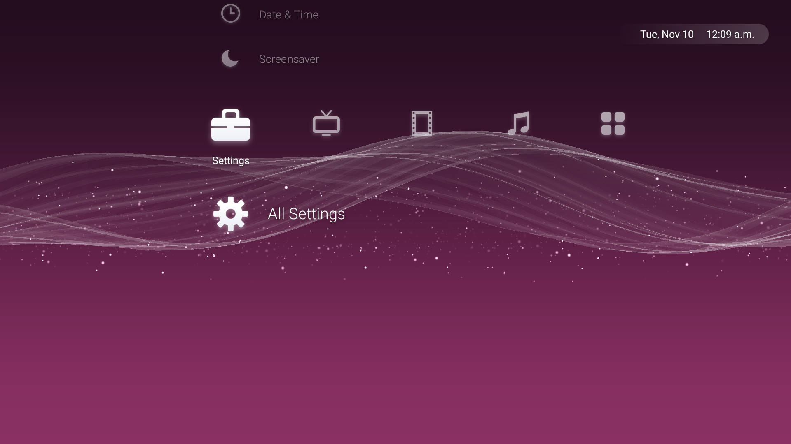

# Google TV Debloat + PS3 UI



Make a Google TV yours, from your computer, with nothing to root. Two parts, usable separately:

1. **Debloat**: turn off ads, tracking and bloat. Nothing gets deleted: apps are **disabled**
   (`pm disable-user`), and one command brings them all back.
2. **Crossbar**: an optional PS3-style home screen with a live, music-reactive wave wallpaper and a
   matching screensaver. See [launcher/README.md](launcher/README.md).

Tested on the **Google TV Streamer 4K** (Android 14). Every one of its 140 packages has a verdict in
[docs/app-inventory.md](docs/app-inventory.md).

## Contents

- [What gets hidden](#what-gets-hidden)
- [How it works](#how-it-works)
- [Requirements](#requirements)
- [Pair once](#pair-once)
- [Run](#run)
- [Customizing](#customizing)
- [Ads on the Home screen](#ads-on-the-home-screen)
- [Troubleshooting](#troubleshooting)
- [Project layout](#project-layout)
- [Notes](#notes)
- [Disclaimer](#disclaimer)

## What gets hidden

The default list, [`lists/debloat-list.txt`](lists/debloat-list.txt), hides 22 packages:

| Group | Packages |
|---|---|
| **Ads and tracking** (10) | Privacy Sandbox ad services (`adservices.api`, `ext.adservices.api`, `sdksandbox`, `ondevicepersonalization`), federated learning (`federatedcompute`), remote-press logging (`tv.remotecontrol.logging`), feedback and crash uploads (`feedback`, `tv.feedbackconsent`), RLZ partner pings (`partnersetup`), Play Auto Install promos (`android.autoinstalls.config.google.sabrina`) |
| **Unused Google apps** (2) | Play Games, Google TV / Play Movies store (`videos`) |
| **Not useful on a TV** (10) | Health Connect (2), Dynamic System Updates, camera extensions, USB file transfer (MTP), Calendar sync, wallpaper picker, basic screensaver, HTML viewer, old Backdrop stub |

Deliberately **kept**, and commented out at the bottom of the list so you can opt in: voice search /
Assistant (`katniss`), Chromecast built-in (`mediashell`), Ambient mode (`dreamx`), TalkBack and
Speech Services.

Never touched: Live TV, the remote, Bluetooth, picture and sound settings, network and core system
services. They're marked **NEVER** in the inventory. Device Lock (`devicelockcontroller`) can't be
hidden at all; Android protects it.

## How it works

- `debloat` disables every package in the list.
- `restore` re-enables them, either all of them or only the ones you name.
- Before every change, both scripts save a snapshot of every package's state to `backups/state-*.txt`,
  and they log each change to `backups/changes.log`.
- Packages the list doesn't name are never touched.

If a package refuses to be disabled, the script falls back to `pm uninstall -k --user 0`. That only
removes the app for your user profile and leaves the APK on the system partition, so `restore` can
bring it back with `cmd package install-existing`.

## Requirements

1. **ADB** (Android platform-tools). Download it from
   [developer.android.com/tools/releases/platform-tools](https://developer.android.com/tools/releases/platform-tools)
   and unzip it into `tools/` so you have `tools/platform-tools/adb`, or install it so `adb` is on your PATH.
2. **Developer options on the TV**: Settings → System → About → click *Android TV OS build* 7 times.
3. **Wireless debugging**: Settings → System → Developer options → Wireless debugging → On. Your TV
   and computer must be on the same network.

## Pair once

On the TV, open Wireless debugging → **Pair device with pairing code**. The popup shows a 6-digit
code and an `IP:port` that's only for pairing. Keep it open while you run:

```bash
adb pair 192.168.1.50:37123 123456
```

The main Wireless debugging screen shows a different `IP:port`. Use that one for every command below.
(`192.168.1.50` and the ports here are only examples. Replace them with what your TV shows.)

## Run

Always start with a dry run. It shows what would change and changes nothing.

**Windows (PowerShell)**

```powershell
powershell -ExecutionPolicy Bypass -File .\debloat.ps1 -Device 192.168.1.50:5555 -DryRun
powershell -ExecutionPolicy Bypass -File .\debloat.ps1 -Device 192.168.1.50:5555
powershell -ExecutionPolicy Bypass -File .\restore.ps1 -Device 192.168.1.50:5555
powershell -ExecutionPolicy Bypass -File .\restore.ps1 -Device 192.168.1.50:5555 -Package com.google.android.katniss
```

**macOS / Linux (bash)**

```bash
bash debloat.sh -d 192.168.1.50:5555 -n     # dry run
bash debloat.sh -d 192.168.1.50:5555
bash restore.sh -d 192.168.1.50:5555
bash restore.sh -d 192.168.1.50:5555 -p com.google.android.katniss
```

If only one device is connected, you can leave out `-Device` / `-d`. To use a different list, pass
`-List` / `-l <file>`.

## Customizing

Edit `lists/debloat-list.txt`, with one package per line (`#` starts a comment). Check
[docs/app-inventory.md](docs/app-inventory.md) for what each package does before you add it. If you
take a package out of the list, `restore` no longer touches it, so run restore *before* you remove a
package you want back.

The inventory is generated from [`packages.csv`](packages.csv). After editing the CSV, regenerate it:

```bash
bash docs/generate-inventory.sh
```

## Ads on the Home screen

Most ads come from Google TV's own home screen (`launcherx`), which can't be disabled without
breaking Home, its quick-settings panel and the setup wizard. Two ways around them:

- **Use Crossbar** ([launcher/README.md](launcher/README.md)): an ad-free home screen in front of
  Google TV, which keeps running underneath.
- **Or tone down Google TV** (menu names vary a little between software versions):
  - **Apps only mode**: Settings → Accounts & sign-in → your account → Apps only mode. This removes
    recommendations and promoted content from Home.
  - Settings → Privacy → Usage & diagnostics → Off.
  - Settings → Privacy → Ads → Delete advertising ID / Opt out of personalization.

## Troubleshooting

| Problem | Fix |
|---|---|
| `failed to connect` | Check the `IP:port` on the main Wireless debugging screen. The port changes whenever the TV restarts or Wireless debugging is turned off and on. |
| Device shows as `offline` | The TV no longer trusts this computer. Pair again (see [Pair once](#pair-once)), using the popup's own port. |
| `adb pair` hangs | You used the main screen's port. Pairing needs the port shown inside the pairing popup, while the popup is open. |
| PowerShell says scripts are disabled | Run them as shown, with `powershell -ExecutionPolicy Bypass -File …`. |
| An app came back after an update | System updates can re-enable apps. Run `debloat` again; already-hidden packages are skipped. |

## Project layout

| Path | What it is |
|---|---|
| `debloat.ps1`, `restore.ps1`, `common.ps1` | Windows scripts |
| `debloat.sh`, `restore.sh`, `common.sh` | macOS / Linux scripts |
| `lists/debloat-list.txt` | The packages to hide |
| `packages.csv` | Every package on the TV, with its group, verdict and description |
| `docs/app-inventory.md` | The same, as a readable table (generated) |
| `docs/generate-inventory.sh` | Regenerates the inventory from the CSV |
| `launcher/` | Crossbar, the PS3-style home screen |
| `tools/` | Your local ADB and build tools (git-ignored) |
| `backups/` | Per-device snapshots and change log (git-ignored) |

## Notes

- A factory reset re-enables everything. Re-run `debloat` afterwards.
- When you're done, turn Wireless debugging off on the TV. Nothing here needs it once it's set up.
- To use another Google TV / Android TV device, run `adb shell pm list packages -u`, compare it with
  the inventory, and open a PR with a list for that device.

## Disclaimer

Use at your own risk. Everything this tool does can be undone with `restore` or a factory reset.
Not affiliated with or endorsed by Google.
