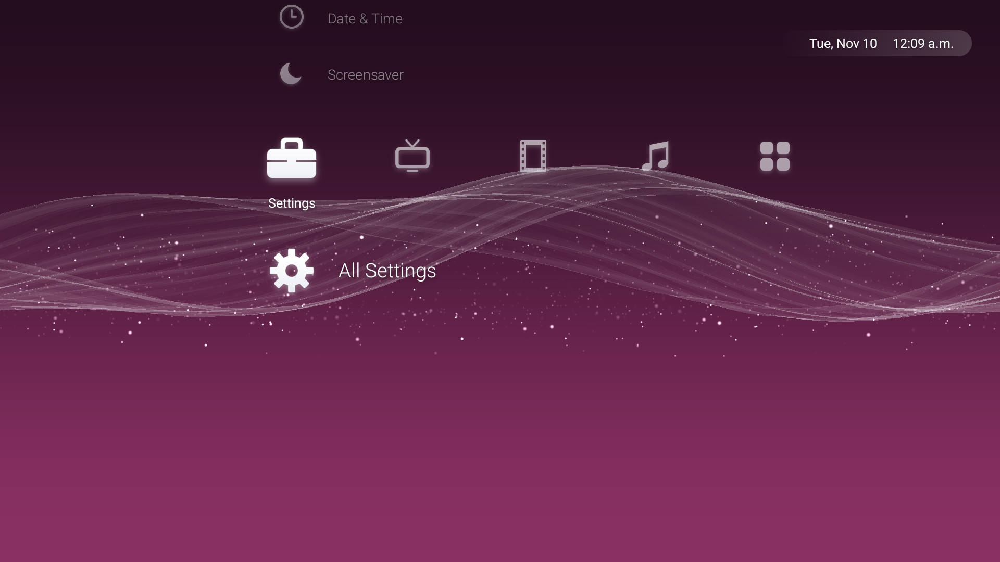

# Crossbar: a PS3-style Home screen for Google TV



A minimal home screen in the spirit of the PlayStation 3's cross-media bar, modernized: a slow,
glowing wave behind a row of categories, with your apps in a column underneath. Built and tested
on the Google TV Streamer 4K (Android 14) at a steady 60 fps.

## Contents

- [Features](#features)
- [What's in each column](#whats-in-each-column)
- [Remote](#remote)
- [Install](#install)
- [Make it your Home screen](#make-it-your-home-screen)
- [Permissions](#permissions)
- [Screensaver](#screensaver)
- [Wave Controls](#wave-controls)
- [Switch back](#switch-back)
- [Limitations](#limitations)
- [Troubleshooting](#troubleshooting)
- [Build](#build)
- [Source layout](#source-layout)
- [Credits](#credits)

## Features

- **Categories:** Settings · TV · Video · Music · Apps, filled automatically from what's installed.
  Netflix, YouTube, Disney+, Prime Video, Spotify, Pluto TV, TuneIn and other well-known apps are
  placed by name; everything else goes by the category the app declares. New apps show up as soon
  as they're installed.
- **Motion:** every move takes 1/6 s and eases out, like the PS3. Crossbar remembers where you were
  in each column.
- **Wallpaper:** the PS3 wave, drawn with OpenGL ES 3. Themes (Settings → Theme):
  - **Monthly**: the console's month colors, brighter by day and darker at night;
  - **Purple**, **Classic Blue**, **Black**, **Pink**;
  - **Custom**: whatever you set in [Wave Controls](#wave-controls).
- **Music:** while something plays, on the home screen and in the screensaver, the wave flows
  faster, its glow rises and falls with the song, and sparkles grow more numerous and brighter in the
  loud parts. It uses Android's audio visualizer on what the TV plays; no microphone.
- **Screensaver:** the same moving wave with Google TV's Ambient layout on top. See [Screensaver](#screensaver).
- **Clock** in the top right, and **navigation sounds** with a startup chime when the TV wakes.
  Settings → Sounds picks the set (moving through the list lets you hear each one):
  - **Zen** (default): paper, soft wood and quiet chimes from the [uisfx](https://uisfx.com) "zen"
    pack (CC0). Up/Down plays `hover`, Left/Right `swipe`, OK `open`, Back `back`, waking up `wake`.
  - **Original**: Crossbar's own synthesized ticks, chimes and startup swell.
  - **Off**.
- **Google TV stays underneath.** Hold Home for Google's own quick-settings panel (media controls,
  Google Home devices, Wi-Fi, Bluetooth, notifications). The YouTube and Netflix buttons,
  Assistant/Gemini, and the full Google TV home (TV → Google TV) all keep working.
- **No ads, no tracking.** The only network request is the screensaver's weather, from
  [Open-Meteo](https://open-meteo.com), with the TV's location rounded to about 1 km. About 75 KB,
  plain Java with no libraries.

## What's in each column

| Column | Items |
|---|---|
| **Settings** | Theme, Wave Controls, Sounds, Display & Sound, Network & Internet, Pair Remote or Accessory, Ambient Mode (Google's screensaver settings), Date & Time, Screensaver (starts it now), All Settings |
| **TV** | Pluto TV (a "Get Pluto TV" Play Store link until it's installed), other live-TV apps, Google TV (Google's full home: recommendations, Continue Watching, profiles), Search (Assistant / Gemini) |
| **Video** | Netflix, YouTube, Disney+, Prime Video, then other video apps |
| **Music** | Spotify, TuneIn (a "Get TuneIn" link until it's installed), then other music apps |
| **Apps** | Play Store first, then everything else, alphabetically |

Settings shortcuts this TV can't open are left out automatically.

## Remote

| Button | Action |
|---|---|
| Left / Right | Change category |
| Up / Down | Move through the column |
| OK | Open |
| Back | Close a panel, or jump to the top of the column |
| Home | Crossbar |
| Hold Home | Google TV's quick-settings panel |
| YouTube / Netflix | Open YouTube / Netflix |
| Mic / Assistant | Google Assistant / Gemini |

Home, hold Home and the YouTube / Netflix buttons need the button helper (see below). Other
buttons, such as power, volume and input, are never touched.

## Install

Build the APK (see [Build](#build)), then let `set-home.ps1` install it. It also makes sure Google TV
and its setup wizard are enabled, and opens Accessibility on the TV:

```powershell
powershell -ExecutionPolicy Bypass -File .\set-home.ps1 -Device 192.168.1.50:5555
```

Or install it by hand with `adb install -r build/Crossbar.apk`. Crossbar then shows up in Google TV's
apps row, and opens like any app.

## Make it your Home screen

Google TV's Home screen always outranks other launchers, and disabling it breaks things: its
quick-settings panel, the YouTube button and the setup wizard all depend on it. So Crossbar leaves
Google TV in place as the system Home and takes over the **Home button** instead, with a small
accessibility service, **Crossbar Home button**. Turn it on once under **Settings → Accessibility**.
It does this:

- a short press on Home opens Crossbar;
- holding Home opens Google TV's quick-settings panel;
- the YouTube and Netflix buttons open their apps (Google's launcher normally does this, but Android
  stops it from opening apps while it isn't the screen in front);
- if Google TV's home screen comes up on its own (waking up, an app sending you home), Crossbar
  replaces it, unless you opened Google TV from Crossbar's TV column.

It only looks at those buttons and at which app is in front, never at what's on screen. If it's off,
the TV simply behaves like plain Google TV.

**Lamps and other Google Home devices.** While *any* accessibility service is running, Google's
smart-home screens switch to an accessibility mode where OK only turns a light on or off, and
Left/Right no longer change its brightness. So when you hold Home, the helper opens Google's panel
and then steps aside; as soon as you leave Google's screens, Crossbar switches it back on (and if you
pressed Home meanwhile, brings up Crossbar). It only re-enables a helper it paused itself, never one
you turned off. This needs two extra permissions, below; without them the helper just stays on and
brightness only works from the Google Home phone app.

## Permissions

Each feature switches itself off without its permission; nothing else breaks.

| Permission | Used for | How to grant |
|---|---|---|
| Accessibility: Crossbar Home button | Home, hold Home, YouTube / Netflix buttons | On the TV: Settings → Accessibility |
| `RECORD_AUDIO` | The music-reactive wave. Android files its audio visualizer under the microphone permission; Crossbar only reads what the TV plays. | `adb shell pm grant` (below) |
| `ACCESS_COARSE_LOCATION`, `ACCESS_FINE_LOCATION` | Screensaver weather for where the TV is, and the Wi-Fi name (Android hides it otherwise) | `adb shell pm grant` (below) |
| Notification access | Now playing on the screensaver; also keeps Crossbar running so a paused helper is restored after a restart | `adb shell cmd notification allow_listener` (below) |
| `WRITE_SECURE_SETTINGS` | Pausing and restoring the Home button helper while Google's panel is open. Crossbar only ever changes its own accessibility entry. | `adb shell pm grant` (below) |
| Usage access | Seeing which screen is in front, to know when you've left Google's panel | `adb shell appops set` (below) |

```bash
adb shell pm grant com.gtvdebloat.crossbar android.permission.RECORD_AUDIO
adb shell pm grant com.gtvdebloat.crossbar android.permission.ACCESS_COARSE_LOCATION
adb shell pm grant com.gtvdebloat.crossbar android.permission.ACCESS_FINE_LOCATION
adb shell cmd notification allow_listener com.gtvdebloat.crossbar/com.gtvdebloat.crossbar.NotifListener
adb shell pm grant com.gtvdebloat.crossbar android.permission.WRITE_SECURE_SETTINGS
adb shell appops set com.gtvdebloat.crossbar GET_USAGE_STATS allow
```

All of them can be revoked anytime under Settings → Apps → Crossbar (or
`adb shell pm revoke` / `adb shell appops set … ignore`).

## Screensaver

The moving wave (with your theme, Wave Controls and music reaction), laid out like Google TV's
Ambient mode:

- top right: device name and Wi-Fi network;
- bottom left: now playing, with album art;
- bottom right: weather (refreshed every 30 minutes) and the time.

It drifts a few pixels over time so nothing marks an OLED panel. Make it the TV's screensaver:

```bash
adb shell settings put secure screensaver_components com.gtvdebloat.crossbar/com.gtvdebloat.crossbar.WaveDream
```

Google's Ambient mode is `com.google.android.apps.tv.dreamx/.service.Backdrop`. Settings → Screensaver
in Crossbar starts it right away. Changing the screensaver in Google's Ambient Mode settings may
switch it back to Google's.

## Wave Controls

Settings → Wave Controls: every wallpaper setting as a slider, with the same names, ranges and
defaults as the web version's panels.

- **Spline Controls**: Gradient Preset, Color R/G/B, Gradient Top/Bot Mul, Flow Speed, Tension,
  Damping, Length, Spacing, the band, travel and perturbation settings, the "Re…" pipeline settings,
  Fresnel, Opacity, Brightness, and the FFD scales, offsets and amplitudes.
- **Particles Controls**: Count (up to 4000), Opacity, Size Base, Size Var, Flow Speed.
- **Colors** (not in the web version): wave and sparkle red, green and blue.

The background settings (Gradient Preset: the RGB sliders, or any of the 24 PS3 month colors, day or
night) are the **Custom** theme. Moving one of them switches the theme to Custom automatically.

Up/Down picks a row, Left/Right moves it (hold to speed up), OK resets that row, and the last row
resets everything. A faint tick marks each default, and • marks changed values. The menu fades away
while the panel is open so you see the whole wave. Changes show live, are saved, and also apply to
the screensaver.

## Switch back

Turn off **Crossbar Home button** in Settings → Accessibility, and the TV is plain Google TV again.
To also uninstall Crossbar (this also re-enables Google TV and its setup wizard, in case an older
version of `set-home.ps1` disabled them):

```powershell
powershell -ExecutionPolicy Bypass -File .\restore-home.ps1 -Device 192.168.1.50:5555 -Uninstall
```

## Limitations

These come from Android or Google, not from Crossbar:

- **No Google recommendations or "previews" inside Crossbar.** Google's launcher loads them from
  Google's servers, and other apps can't. TV → Google TV opens Google's own home for them.
- **Google's quick-settings panel can't be restyled.** Its launcher exposes nothing other apps may
  theme, and this TV has background blur turned off.
- **No HDMI input switching.** Telling the TV to change inputs takes HDMI-CEC, which Android reserves
  for system apps. The remote's input button still works.
- **Live TV** depends on your region: Google TV Freeplay is US-only, so Crossbar doesn't show a Live
  TV item. Use Pluto TV or another live-TV app.
- **ADB can't test the remote buttons.** Keys sent with `adb shell input` skip accessibility
  services, so test Home and the app buttons with the real remote.

## Troubleshooting

| Problem | Fix |
|---|---|
| Home opens Google TV | Turn on **Crossbar Home button** in Settings → Accessibility. Updating Crossbar keeps it on; reinstalling from scratch doesn't. |
| The wave doesn't react to music | Grant `RECORD_AUDIO`. Without it the wave only flows a little faster. The reaction shows on Crossbar and the screensaver, not while the music app is on screen. |
| The screensaver shows "Wi-Fi" instead of the network name, or no weather | Grant the location permissions. Weather also needs the TV to be online. |
| No "now playing" on the screensaver | Grant notification access. |
| Colors don't change in Wave Controls | Background colors only show on the Custom theme. Moving one switches to it; or pick Settings → Theme → Custom. |
| Left/Right doesn't change a lamp's brightness | Grant `WRITE_SECURE_SETTINGS` and usage access, and open the panel by holding Home (that's when the helper steps aside). |
| The helper shows as off in Accessibility | Normal while Google's panel or smart-home screen is open; it comes back when you leave them. If it stays off elsewhere, turn it on again in Settings → Accessibility. |

For debugging, `adb shell setprop log.tag.Crossbar DEBUG` makes Crossbar log the wave's frame rate
and music readings every 5 seconds (`adb logcat -s Crossbar`).

## Build

Windows only for now (the script uses the Windows build tools). You need, under `../tools`
(git-ignored):

- Eclipse Temurin JDK 17 (`jdk-17*`)
- Android build-tools 34 (`android-sdk/build-tools/34.0.0`)
- the Android 14 platform (`android-sdk/platforms/android-34`)

```powershell
powershell -ExecutionPolicy Bypass -File .\build.ps1
powershell -ExecutionPolicy Bypass -File .\build.ps1 -VersionCode 25 -VersionName 1.1
```

It builds with plain `aapt2`, `javac` and `d8` (no Gradle) and writes `build/Crossbar.apk`. The
first build creates a local signing key in `signing/`. Keep it: updates must be signed with the same
key to install over the previous version.

## Source layout

| File | What it does |
|---|---|
| `HomeActivity.java` | The home screen: wires everything together, launches apps, themes and panels |
| `XmbView.java` | The menu: layout, motion, Theme and Sounds panels, clock |
| `Catalog.java` | Builds the columns from installed apps and settings shortcuts |
| `WaveView.java` | OpenGL renderer: background, wave and sparkles, music reaction |
| `SplineField.java` | CPU wave displacement field (ported from the web version) |
| `WaveSettings.java` | Every wallpaper setting, saved on the TV |
| `WaveControls.java` | The Wave Controls slider panel |
| `Themes.java` | Theme and PS3 month colors |
| `AudioPulse.java` | Measures how loud the TV's audio is |
| `WaveDream.java`, `AmbientView.java` | The screensaver and its overlay |
| `Weather.java`, `DeviceStatus.java`, `NotifListener.java` | Weather, network name, now playing |
| `KeyService.java` | The Home button helper (accessibility service) |
| `HelperPause.java` | Steps the helper aside while Google's panel is open, then restores it |
| `Glyphs.java` | Original icons |
| `Sounds.java` | Navigation sounds: the Zen set from `res/raw`, or the synthesized Original set |

## Credits

- The wave shaders, displacement field, Wave Controls' settings and PS3 month colors are ported from
  [linkev/PlayStation-3-XMB](https://github.com/linkev/PlayStation-3-XMB) (MIT License, © 2025 Mart).
  See [THIRD_PARTY_LICENSE-PlayStation-3-XMB.txt](THIRD_PARTY_LICENSE-PlayStation-3-XMB.txt).
- The Zen sounds (`res/raw/zen_*.ogg`) are from [uisfx](https://github.com/romainsimon/uisfx), dedicated
  to the public domain under CC0 1.0. See [THIRD_PARTY_LICENSE-uisfx-audio.txt](THIRD_PARTY_LICENSE-uisfx-audio.txt).
- The icons and the Original sound set are made for Crossbar.
- Fan-made and unofficial. Not affiliated with or endorsed by Sony Interactive Entertainment or Google.
  PlayStation and XMB are trademarks of Sony Interactive Entertainment.
